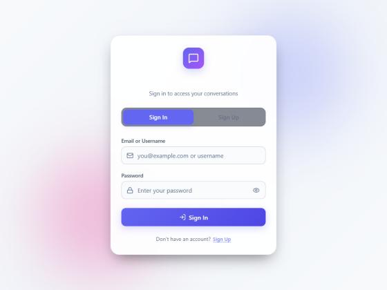
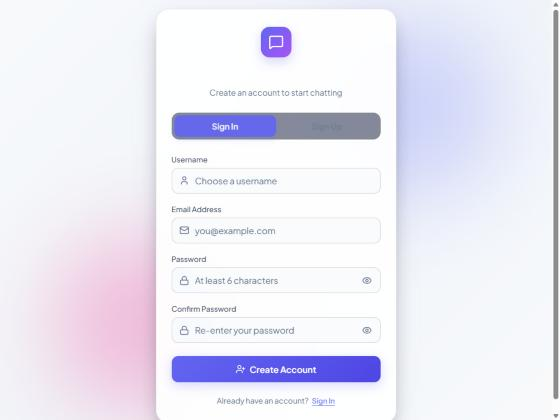
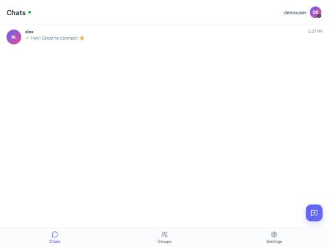
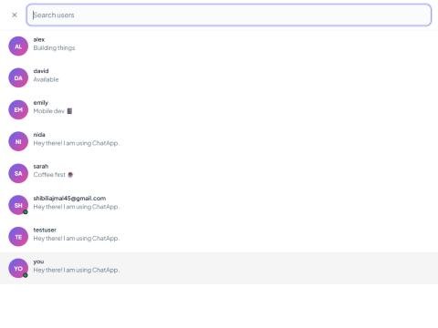
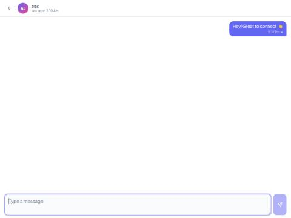
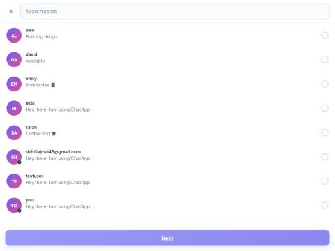
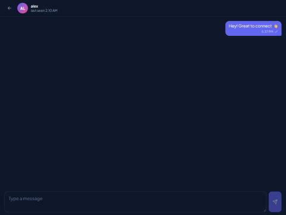
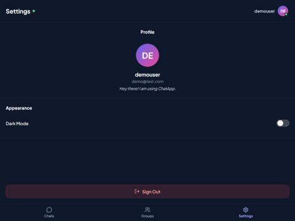

<div align="center">

# 💬 MongoChat

### A full-stack real-time chat application built with the MERN stack + Socket.IO

[](https://react.dev/)
[](https://nodejs.org/)
[](https://mongodb.com/)
[](https://socket.io/)
[](https://vitejs.dev/)
[](LICENSE)

</div>

---

## 📸 Screenshots

<div align="center">

### 🔐 Authentication
<table>
  <tr>
    <td align="center"><b>Sign In</b></td>
    <td align="center"><b>Sign Up</b></td>
  </tr>
  <tr>
    <td></td>
    <td></td>
  </tr>
</table>

### 💬 Chats
<table>
  <tr>
    <td align="center"><b>Conversations List</b></td>
    <td align="center"><b>Find Users</b></td>
  </tr>
  <tr>
    <td></td>
    <td></td>
  </tr>
  <tr>
    <td align="center"><b>Send a Message</b></td>
    <td align="center"><b>Create Group (member picker)</b></td>
  </tr>
  <tr>
    <td></td>
    <td></td>
  </tr>
</table>

### 🌙 Dark Mode
<table>
  <tr>
    <td align="center"><b>Chats — Dark</b></td>
    <td align="center"><b>Settings — Dark</b></td>
  </tr>
  <tr>
    <td></td>
    <td></td>
  </tr>
</table>

</div>

---

## ✨ Features

### Core Chat Features
- **Real-time messaging** — Instant message delivery via Socket.IO with zero page refresh
- **1-on-1 conversations** — Start a private chat with any registered user
- **Group chats** — Create and manage group conversations with multiple members
- **Online presence** — Live online/offline indicators with last-seen timestamps
- **Typing indicators** — See when someone is typing in real time
- **Read receipts** — Double-tick system (sent → delivered → read) with per-message status
- **Unread counts** — Per-conversation unread badges that reset when you open the chat

### Authentication & Security
- **JWT authentication** — Stateless auth with configurable expiry
- **bcrypt password hashing** — Passwords are salted & hashed, never stored in plain text
- **Protected routes** — Every API endpoint and Socket.IO connection is guarded by middleware
- **Persistent sessions** — Token stored in `localStorage`, validated against the server on page load

### Groups
- **Create groups** — Name, description, and select members from your contacts
- **Admin controls** — Promote/demote admins, add/remove members
- **System messages** — Auto-generated notices for join/leave events

### UI / UX
- **Light & dark themes** — Toggle from Settings; preference stored in `localStorage`
- **Ambient glow** — Animated gradient background on the auth screen
- **Mobile-first layout** — Tab-bar navigation (Chats · Groups · Settings) with a FAB for new conversations
- **Avatar initials** — Colour-coded avatar tiles when no profile image is set

---

## 🛠️ Tech Stack

| Layer | Technology | Why |
|-------|-----------|-----|
| **Frontend** | React 19 + Vite 8 | Fast HMR, modern JSX, no config overhead |
| **Styling** | Pure CSS (1500+ lines) with CSS variables | Custom design system, light/dark tokens, zero runtime overhead |
| **Icons** | Lucide React | Consistent, accessible SVG icons |
| **Real-time** | Socket.IO (client) | Bidirectional, event-driven messaging |
| **Backend** | Node.js + Express 5 | Minimal footprint, async error forwarding in Express 5 |
| **Database** | MongoDB via Mongoose 9 | Flexible schema for conversations + messages; compound indexes for pagination |
| **Real-time** | Socket.IO (server) | Namespaced rooms per user; presence tracking in memory |
| **Auth** | JWT (jsonwebtoken) + bcryptjs | Industry-standard stateless auth |
| **Build** | Vite proxy for local dev | `/api` and `/socket.io` proxied to Express, so the client calls a single origin |

---

## 🏗️ Project Architecture

```
ChatApp/
├── client/                    # React SPA (Vite)
│   └── src/
│       ├── components/
│       │   ├── Login.jsx         # Sign-in form with validation
│       │   ├── Register.jsx      # Sign-up form with confirm-password check
│       │   ├── Home.jsx          # Main layout: tab bar + conversation panel
│       │   ├── chat/
│       │   │   ├── ConversationView.jsx  # Message thread + input box
│       │   │   ├── ChatParts.jsx         # Reusable Avatar, MessageBubble, etc.
│       │   │   └── UserPicker.jsx        # Search-to-start-chat modal
│       │   ├── groups/
│       │   │   ├── CreateGroup.jsx       # Member selector → name/desc form
│       │   │   └── GroupInfo.jsx         # Group details + member management
│       │   └── tabs/
│       │       ├── ChatsTab.jsx          # 1:1 conversation list
│       │       ├── GroupsTab.jsx         # Group list + FAB
│       │       └── SettingsTab.jsx       # Profile view + dark-mode toggle
│       ├── context/
│       │   └── SocketContext.jsx   # Socket.IO connection + event listeners
│       ├── hooks/
│       │   └── useTyping.js        # Debounced typing start/stop emitter
│       └── lib/
│           ├── api.js              # Fetch wrapper + chatApi / groupApi helpers
│           ├── format.js           # Date, name, ID utilities
│           └── socketEvents.js     # Shared event-name constants (mirrors server)
│
└── server/                    # Node.js / Express API
    ├── server.js                 # App bootstrap: DB connect, middleware, routes, Socket.IO
    ├── models/
    │   ├── User.js               # username, email, bcrypt hash, online/lastSeen
    │   ├── Conversation.js       # Unified model for DMs & groups; unreadCounts Map
    │   └── Message.js            # content, type (text/image/file/system), readBy[]
    ├── controllers/
    │   ├── authController.js     # register, login, getMe
    │   ├── conversationController.js  # list, create, getMessages, markRead
    │   ├── groupController.js    # CRUD + member/admin management
    │   └── userController.js     # searchUsers
    ├── routes/                   # Express routers (all protected by verifyToken)
    ├── middleware/
    │   └── auth.js               # JWT verify → attach req.user
    ├── services/
    │   ├── chatService.js        # DB logic: createMessage, markRead, etc.
    │   └── groupService.js       # Group creation + membership logic
    ├── socket/
    │   ├── index.js              # initSocket: attach IO to HTTP server
    │   ├── events.js             # Shared event-name constants
    │   ├── presence.js           # In-memory connection counter per user
    │   ├── emitters.js           # setIO() + emit helpers (emitNewMessage, etc.)
    │   ├── middleware/
    │   │   └── socketAuth.js     # JWT verify on handshake → socket.data.userId
    │   └── handlers/
    │       ├── chatHandlers.js   # message:send, message:read, typing:start/stop
    │       └── presenceHandlers.js  # connect/disconnect → online status update
    └── utils/
        └── HttpError.js          # Custom error class with HTTP status code
```

---

## ⚡ Database Design

### `users`
| Field | Type | Notes |
|-------|------|-------|
| `username` | String | unique, 3–30 chars |
| `email` | String | unique, lowercase |
| `password` | String | bcrypt hash, `select: false` |
| `isOnline` | Boolean | updated via Socket.IO presence |
| `lastSeen` | Date | set on disconnect |
| `about` | String | max 140 chars |

### `conversations`
| Field | Type | Notes |
|-------|------|-------|
| `participants` | ObjectId[] | 2 for DM, 1+ for group |
| `isGroup` | Boolean | single collection for both types |
| `unreadCounts` | Map<userId, Number> | O(1) badge lookup |
| `lastMessage` | ObjectId ref | for conversation list preview |
| `name`, `description`, `admins` | — | group-only fields |

### `messages`
| Field | Type | Notes |
|-------|------|-------|
| `conversationId` | ObjectId | indexed with `createdAt` for cursor pagination |
| `sender` | ObjectId | |
| `content` | String | max 5000 chars |
| `messageType` | Enum | `text` \| `image` \| `file` \| `system` |
| `status` | Enum | `sent` → `delivered` → `read` |
| `readBy` | ObjectId[] | for group read receipts |

---

## 🔌 Real-Time Socket Events

| Direction | Event | Payload | Description |
|-----------|-------|---------|-------------|
| Client → Server | `message:send` | `{ conversationId, content, messageType? }` | Send a message (ack returns saved message) |
| Client → Server | `message:read` | `{ conversationId }` | Mark all messages as read |
| Client → Server | `typing:start` | `{ conversationId }` | Notify others you're typing |
| Client → Server | `typing:stop` | `{ conversationId }` | Stop typing indicator |
| Server → Client | `message:new` | `{ message, isGroup }` | New message pushed to recipients |
| Server → Client | `messages:read` | `{ conversationId, readerId }` | Update tick status for sender |
| Server → Client | `typing` | `{ conversationId, userId, isTyping }` | Typing indicator state |
| Server → Client | `presence:update` | `{ userId, isOnline, lastSeen }` | Online/offline status change |
| Server → Client | `group:upsert` | `{ group }` | Group created or updated |
| Server → Client | `group:removed` | `{ groupId }` | Removed from a group |

---

## 🚀 Getting Started

### Prerequisites
- **Node.js** 18+
- **MongoDB** (Atlas or local instance)

### 1 — Clone the repo

```bash
git clone https://github.com/DevShibz/MongoChat.git
cd MongoChat
```

### 2 — Set up environment variables

Create `server/.env`:

```env
PORT=5000
MONGODB_URI=mongodb+srv://<user>:<pass>@cluster.mongodb.net/
DB_NAME=chatapp
JWT_SECRET=your_super_secret_key_here
JWT_EXPIRES_IN=7d
CLIENT_ORIGIN=http://localhost:3000
```

### 3 — Install dependencies

```bash
# Server
cd server && npm install

# Client
cd ../client && npm install
```

### 4 — Run in development

Open two terminals:

```bash
# Terminal 1 — API server (port 5000)
cd server && npm run dev

# Terminal 2 — Vite dev server (port 3000)
cd client && npm run dev
```

Then open [http://localhost:3000](http://localhost:3000).

### 5 — Seed sample data (optional)

```bash
cd server && npm run seed
```

---

## 📡 REST API Reference

### Auth
| Method | Endpoint | Auth | Description |
|--------|----------|------|-------------|
| `POST` | `/api/auth/register` | ❌ | Create account |
| `POST` | `/api/auth/login` | ❌ | Sign in, returns JWT |
| `GET` | `/api/auth/me` | ✅ | Verify token + return user |

### Conversations
| Method | Endpoint | Description |
|--------|----------|-------------|
| `GET` | `/api/conversations` | List all conversations |
| `POST` | `/api/conversations` | Start a DM (`{ userId }`) |
| `GET` | `/api/conversations/:id/messages` | Paginated message history |
| `POST` | `/api/conversations/:id/messages` | Send a message via REST |
| `PATCH` | `/api/conversations/:id/read` | Mark all as read |

### Groups
| Method | Endpoint | Description |
|--------|----------|-------------|
| `GET` | `/api/groups` | List joined groups |
| `POST` | `/api/groups` | Create group (`name`, `description`, `memberIds[]`) |
| `PATCH` | `/api/groups/:id` | Rename / update description |
| `POST` | `/api/groups/:id/members` | Add members |
| `DELETE` | `/api/groups/:id/members/:userId` | Remove a member |
| `PUT` | `/api/groups/:id/admins/:userId` | Make admin |

---

## 🔧 Configuration Notes

- **Vite proxy** — All `/api` and `/socket.io` requests from the client are proxied to `localhost:5000` during development; no CORS configuration needed locally.
- **Presence** — Online state is tracked in-memory (`Map<userId, connectionCount>`). For multi-process deployments, swap this for a Redis adapter.
- **JWT** — Token expiry is controlled by `JWT_EXPIRES_IN` in `.env`. The client validates the stored token against `/api/auth/me` on every page load.
- **Error handling** — Express 5's native async error forwarding is used, so `async` route handlers don't need `try/catch` wrappers. A central handler maps errors to HTTP responses.

---

## 👨‍💻 Author

**Shibili Ajmal** — [@DevShibz](https://github.com/DevShibz)

---

<div align="center">
  <sub>Built with ❤️ using the MERN stack + Socket.IO</sub>
</div>
